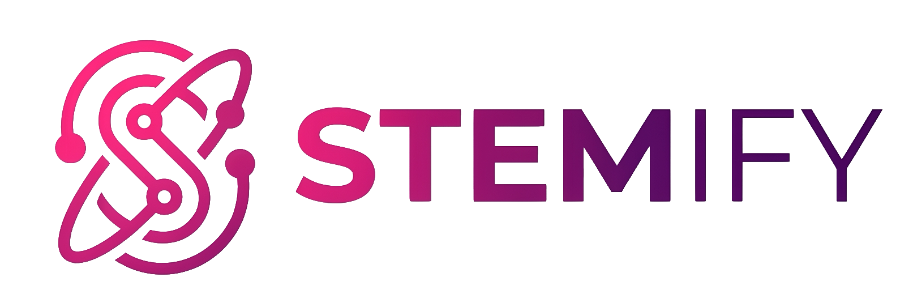

<p align="center">
  
</p>

# Stemify - The Audio Splitter

[](https://opensource.org/licenses/MIT)
[](https://python.org)
[](https://reactjs.org)
[](https://flask.palletsprojects.com)
[](https://github.com/facebookresearch/demucs)
[]()

Split any song into **vocals, drums, bass and instrumental** with AI — available as a **desktop app** (macOS, Windows, Linux) or as a **self-hosted web app**.

## ✨ Features

- 🖥️ **Desktop app** — native Electron app with bundled Python backend, no setup required
- 🎚️ **AI stem separation** — Facebook Research Demucs v4 (htdemucs)
- 📊 **BPM & musical key detection** — automatically analyzed and embedded in the filenames
- 📈 **Real-time progress bar** — track the separation percentage as it runs
- 🎹 **Built-in library** — all your past separations, ready to replay, re-download or delete
- 🌊 **Interactive waveforms** — click-to-seek custom player for every stem
- 📦 **One-click ZIP download** — all stems in a single archive named after the song
- ⚡ **GPU acceleration** — Metal (MPS) on Apple Silicon with automatic CPU fallback

## 📥 Desktop App

Download the installer for your platform from the [Releases](https://github.com/huchukato/stemify-audio-splitter/releases) page:

| Platform | File | Notes |
|---|---|---|
| macOS (Apple Silicon) | `Stemify-<ver>-arm64.dmg` | First launch: right-click → Open (unsigned app) |
| Windows | `Stemify Setup <ver>.exe` | x64 |
| Linux | `Stemify-<ver>.AppImage` | x64 |

The app bundles its own Python backend (PyInstaller) — the Demucs model (~84 MB) is downloaded automatically on first use.

### Build the desktop app yourself

```bash
cd demucs-gui
npm install
npm run electron-build   # builds frontend + PyInstaller backend + electron-builder
```

Artifacts land in `demucs-gui/release/`.

## 🌐 Web App (self-hosted)

### Prerequisites

- Python 3.12+
- [uv](https://docs.astral.sh/uv/) — `curl -LsSf https://astral.sh/uv/install.sh | sh`
- npm (Node.js 18+)

### Quick start (Linux / macOS)

```bash
git clone https://github.com/huchukato/stemify-audio-splitter.git
cd stemify-audio-splitter
./linux_mac_install_run.sh
```

Then open `http://localhost:5173`.

### Windows

```powershell
git clone https://github.com/huchukato/stemify-audio-splitter.git
cd stemify-audio-splitter
.\win_install_run.bat
```

### Manual

```bash
# Backend
cd demucs-backend
uv sync
uv run python -m gunicorn --bind 0.0.0.0:5001 --workers 1 --timeout 600 app:app

# Frontend (another terminal)
cd demucs-gui
npm install
npm run dev
```

## 🎵 How to Use

1. Drop an MP3 (up to 20 MB) into the app
2. Watch the progress bar while the AI separates the stems
3. Preview each stem with the built-in player (click the waveform to seek)
4. Download single stems or the whole ZIP — filenames include BPM and key, e.g. `Song-83bpm-Emajor-vocals.mp3`
5. Find every past separation in the **Library** — replay, re-download or delete

## 🛠️ Tech Stack

- **Backend:** Flask + waitress + Demucs v4 + librosa (BPM/key analysis)
- **Frontend:** React 19 + TypeScript + Vite + Tailwind CSS
- **Desktop:** Electron + electron-builder + PyInstaller
- **Package Management:** uv (Python), npm (Node.js)

## 📁 Project Structure

```
├── demucs-backend/     # Flask API server (uv project)
├── demucs-gui/         # React frontend + Electron desktop app
├── packaging/          # PyInstaller entry point for the bundled backend
├── img/                # Brand assets (logo, icons, background)
└── linux_mac_install_run.sh / win_install_run.bat
```

## 🔧 Troubleshooting

- **Backend not starting:** make sure port 5001 is not in use
- **Slow separation:** on macOS the app falls back to CPU if Metal is unavailable — a reboot usually restores GPU acceleration
- **Audio processing fails:** ensure the file is under 20 MB

## 🔒 Security

Regular audits via automated Dependabot monitoring, prompt patching and transparent disclosure.

## 📝 License

This project is open source and available under the [MIT License](LICENSE).

## 👥 Author

- **huchukato**
  - 🐙 [GitHub](https://github.com/huchukato)
  - 🐦 [X (Twitter)](https://twitter.com/huchukato)
  - 🎨 [Civitai](https://civitai.com/user/huchukato) - Check out my AI art models!

## 🙏 Acknowledgments

- [Facebook Research](https://github.com/facebookresearch/demucs) for the Demucs v4 model
- The open-source community for the amazing tools and libraries used in this project
