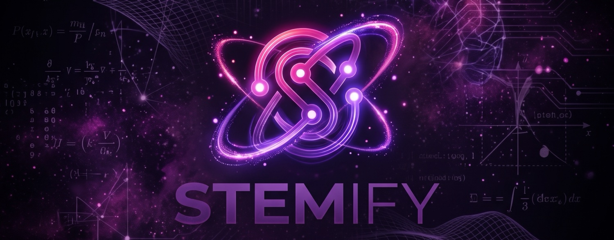
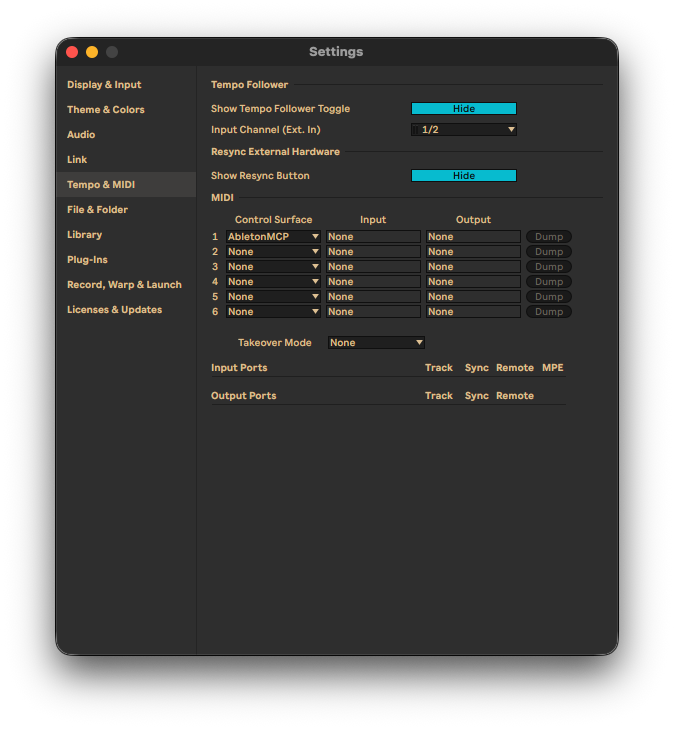

<p align="center">
  
</p>

# Stemify - The Audio Splitter

[](https://opensource.org/licenses/MIT)
[](https://python.org)
[](https://reactjs.org)
[](https://flask.palletsprojects.com)
[](https://github.com/facebookresearch/demucs)
[]()

Separa qualsiasi brano in **voce, batteria, basso e strumentale** con l'AI — disponibile come **app desktop** (macOS, Windows, Linux) o come **app web self-hosted**.

## ✨ Funzionalità

- �️ **App desktop** — app Electron nativa con backend Python incluso, nessuna configurazione richiesta
- 🎚️ **Separazione stem con AI** — Facebook Research Demucs v4 (htdemucs)
- 📊 **Rilevamento BPM e tonalità** — analizzati automaticamente e inclusi nei nomi dei file
- 📈 **Barra di avanzamento in tempo reale** — percentuale di completamento durante l'elaborazione
- 🎹 **Library integrata** — tutte le tue separazioni passate, pronte da riascoltare, riscaricare o eliminare
- 🌊 **Waveform interattive** — player custom con seek cliccando sulla waveform
- 📦 **Download ZIP con un click** — tutti gli stem in un unico archivio col nome della canzone
- 🎛️ **Integrazione Ableton Live** — controlla Ableton con l'AI tramite il server AbletonMCP (vedi sotto)
- ⚡ **Accelerazione GPU** — Metal (MPS) su Apple Silicon con fallback CPU automatico

## 📥 App Desktop

Scarica l'installer per la tua piattaforma dalla pagina [Releases](https://github.com/huchukato/stemify-audio-splitter/releases):

| Piattaforma | File | Note |
|---|---|---|
| macOS (Apple Silicon) | `Stemify-<ver>-arm64.dmg` | Primo avvio: tasto destro → Apri (app non firmata) |
| Windows | `Stemify Setup <ver>.exe` | x64 |
| Linux | `Stemify-<ver>.AppImage` / `.deb` | x64 |

L'app include il proprio backend Python (PyInstaller) — il modello Demucs (~84 MB) viene scaricato automaticamente al primo utilizzo.

### Compila l'app desktop da solo

```bash
cd demucs-gui
npm install
npm run electron-build   # compila frontend + backend PyInstaller + electron-builder
```

Gli artifact finiscono in `demucs-gui/release/`.

## 🌐 App Web (self-hosted)

### Prerequisiti

- Python 3.12+
- [uv](https://docs.astral.sh/uv/) — `curl -LsSf https://astral.sh/uv/install.sh | sh`
- npm (Node.js 18+)

### Avvio rapido (Linux / macOS)

```bash
git clone https://github.com/huchukato/stemify-audio-splitter.git
cd stemify-audio-splitter
./linux_mac_install_run.sh
```

Poi apri `http://localhost:5173`.

### Windows

```powershell
git clone https://github.com/huchukato/stemify-audio-splitter.git
cd stemify-audio-splitter
.\win_install_run.bat
```

### Manuale

```bash
# Backend
cd demucs-backend
uv sync
uv run python -m gunicorn --bind 0.0.0.0:5001 --workers 1 --timeout 600 app:app

# Frontend (altro terminale)
cd demucs-gui
npm install
npm run dev
```

## � Come si usa

1. Trascina un MP3 (max 20 MB) nell'app
2. Guarda la barra di avanzamento mentre l'AI separa gli stem
3. Anteprima di ogni stem con il player integrato (clicca la waveform per il seek)
4. Scarica i singoli stem o lo ZIP completo — i nomi dei file includono BPM e tonalità, es. `Song-83bpm-Emajor-vocals.mp3`
5. Trova tutte le separazioni passate nella **Library** — riascolta, riscarica o elimina

## 🎛️ Usa l'AI con Ableton

Stemify si abbina bene con [Ableton MCP](https://github.com/ahujasid/ableton-mcp): separa un brano, poi lascia che un assistente AI (Claude Desktop, Cursor, Devin) carichi gli stem in Ableton, li arrangi e componga sopra.

Gli script di installazione (`linux_mac_install_run.sh` / `win_install_run.bat`) installano automaticamente il **Remote Script AbletonMCP**. Per installarlo manualmente:

```bash
uvx --from ableton-mcp ableton-mcp-install-script
```

Poi in Ableton: **Settings → Link, Tempo & MIDI → Control Surface → AbletonMCP** (Input/Output: None).

<p align="center">
  
</p>

Per far controllare Ableton a un assistente AI, aggiungi il server MCP alla config del tuo client AI:

```json
{
  "mcpServers": {
    "AbletonMCP": {
      "command": "uvx",
      "args": ["ableton-mcp"]
    }
  }
}
```

## 🛠️ Stack Tecnologico

- **Backend:** Flask + waitress + Demucs v4 + librosa (analisi BPM/tonalità)
- **Frontend:** React 19 + TypeScript + Vite + Tailwind CSS
- **Desktop:** Electron + electron-builder + PyInstaller
- **Gestione pacchetti:** uv (Python), npm (Node.js)

## 📁 Struttura del Progetto

```
├── demucs-backend/     # Server API Flask (progetto uv)
├── demucs-gui/         # Frontend React + app desktop Electron
├── packaging/          # Entry point PyInstaller per il backend incluso
├── img/                # Asset grafici (logo, icone, background)
└── linux_mac_install_run.sh / win_install_run.bat
```

## 🔧 Risoluzione Problemi

- **Il backend non parte:** assicurati che la porta 5001 non sia occupata
- **Separazione lenta:** su macOS l'app passa a CPU se Metal non è disponibile — un riavvio di solito ripristina l'accelerazione GPU
- **Elaborazione fallita:** assicurati che il file sia sotto 20 MB

## 🔒 Sicurezza

Audit regolari tramite monitoraggio automatico Dependabot, patch tempestive e disclosure trasparente.

## 📝 Licenza

Questo progetto è open source e disponibile sotto [licenza MIT](LICENSE).

## 👥 Autore

- **huchukato**
  - 🐙 [GitHub](https://github.com/huchukato)
  - 🐦 [X (Twitter)](https://twitter.com/huchukato)
  - 🎨 [Civitai](https://civitai.red/user/huchukato) - Dai un'occhiata ai miei modelli AI!

## 🙏 Ringraziamenti

- [Facebook Research](https://github.com/facebookresearch/demucs) per il modello Demucs v4
- La community open source per gli strumenti straordinari usati in questo progetto
